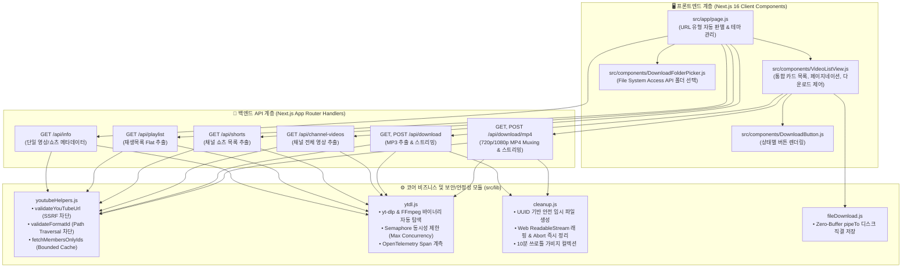

# 시스템 전체 일람, 취약점 진단 및 개선 보고서

> **작성 일자**: 2026-11-01  
> **대상 시스템**: YouTube Downloader (Next.js 16 Fullstack Web & Streaming API Service)  
> **점검 범위**: 프론트엔드 UI(`src/app`, `src/components`), 백엔드 API(`src/app/api`), 코어 모듈(`src/lib`), 컨테이너 및 관측성 인프라(`Dockerfile`, `docker-compose.yml`, OpenTelemetry)

---

## 1. 개요 (Executive Summary)

본 보고서는 **YouTube Downloader** 시스템 전체 코드베이스와 인프라 설정을 전수 조사하여 식별된 **보안 취약점(Security Vulnerabilities)**, **안정성/동시성 결함(Stability & Concurrency Risks)**, **런타임 호환성 문제(Runtime Compatibility)** 및 **코드 품질/UI 버그(Code Quality & UI Bugs)**를 정리하고, 이를 즉시 패치·개선한 결과를 기록한 문서입니다.

### 📊 진단 및 조치 요약 매트릭스

| 분류 | ID | 주요 문제점 및 취약점 | 심각도 | 조치 상태 | 수정 대상 파일 |
| :---: | :---: | :--- | :---: | :---: | :--- |
| **보안** | **SEC-01** | 백엔드 API 6개 엔드포인트의 서버 측 URL 도메인 검증 부재 (SSRF 및 CLI 옵션 인젝션 위험) | **Critical** | ✅ 완료 | `src/lib/youtubeHelpers.js`, `src/app/api/**` |
| **보안** | **SEC-02** | `/api/download`의 `format_id` 미검증 파일 경로 조합으로 인한 Path Traversal 및 인젝션 취약점 | **High** | ✅ 완료 | `src/lib/youtubeHelpers.js`, `src/app/api/download/route.js` |
| **보안** | **SEC-03** | 모든 `yt-dlp` 호출에 `noCheckCertificate: true`가 강제 적용되어 TLS/SSL 검증이 무력화됨 (MITM 위험) | **Medium** | ✅ 완료 | `src/lib/ytdl.js`, `src/app/api/**` |
| **안정성** | **STB-01** | 임시 파일명 생성 시 `Date.now()`만 사용하여 동시 다운로드 요청 시 파일 충돌(Race Condition) 발생 | **High** | ✅ 완료 | `src/lib/cleanup.js`, `src/app/api/download/**` |
| **안정성** | **STB-02** | `yt-dlp`/`ffmpeg` 서브프로세스 동시 실행 제한(Concurrency Limit) 부재로 인한 CPU/RAM 고갈(DoS) 위험 | **High** | ✅ 완료 | `src/lib/ytdl.js` |
| **안정성** | **STB-03** | 채널/플레이리스트/쇼츠 조회 시 상한(`playlistEnd`) 미적용으로 초대형 채널 조회 시 장시간 블로킹 발생 | **Medium** | ✅ 완료 | `src/app/api/channel-videos/route.js`, `playlist/route.js`, `shorts/route.js` |
| **안정성** | **STB-04** | `membersCache` 인메모리 `Map`의 최대 크기 제한(Eviction) 부재로 장기 운영 시 메모리 누수 가능성 | **Low** | ✅ 완료 | `src/lib/youtubeHelpers.js` |
| **호환성** | **CMP-01** | `ffmpeg-static` 경로 하드코딩으로 인해 Docker Standalone 환경(시스템 `/usr/bin/ffmpeg`)과 불일치 | **High** | ✅ 완료 | `src/lib/ytdl.js`, `src/app/api/download/**` |
| **호환성** | **CMP-02** | Node.js `fs.ReadStream` 직접 반환 및 클라이언트 스트림 취소(`abort`/`cancel`) 시 파일 즉시 정리 미흡 | **Medium** | ✅ 완료 | `src/lib/cleanup.js`, `src/app/api/download/**` |
| **호환성** | **CMP-03** | 아키텍처 정의서(`ARCHITECTURE.md`)에 명시된 `POST /api/download/mp4` 미구현 및 다운로드 라우트 코드 중복 | **Medium** | ✅ 완료 | `src/app/api/download/mp4/route.js`, `src/app/api/download/route.js` |
| **품질/UI** | **QAL-01** | `npm run lint` 실패 (React 19 `react-hooks/set-state-in-effect`, `react-hooks/immutability` 에러 2건 및 경고 1건) | **Medium** | ✅ 완료 | `src/app/page.js`, `src/components/VideoListView.js` |
| **품질/UI** | **QAL-02** | `VideoListView`에서 Shorts 목록의 9:16 세로형 썸네일 스타일 미적용 및 새 목록 검색 시 페이지네이션 미초기화 | **Low** | ✅ 완료 | `src/components/VideoListView.js`, `src/app/page.js` |
| **품질/인프라**| **QAL-03** | 최신 `yt-dlp`에서 Deprecated된 옵션(`callHome`, `youtubeSkipDashManifest`) 사용, `.dockerignore` 누락 및 메타데이터 미설정 | **Low** | ✅ 완료 | `src/app/layout.js`, `.dockerignore`, `docker-compose.yml` |

---

## 2. 시스템 전체 구조 일람 (System Overview)

### 2.1 계층별 구성 요소 현황

---

## 3. 문제점 및 취약점 상세 분석

### 3.1 보안 취약점 (Security Vulnerabilities)

#### ① [SEC-01] 백엔드 API 서버 사이드 URL 검증 부재 (Critical)
- **현상**: [ARCHITECTURE.md](file:///Users/windows/work/Util/YoutubeDownload/ARCHITECTURE.md) 8.1절에는 *"요청된 파라미터가 유효한 YouTube 도메인(`youtube.com`, `youtu.be`)인지 정규식 검증"* 이라고 기술되어 있었으나, 실제 백엔드 라우트([info/route.js](file:///Users/windows/work/Util/YoutubeDownload/src/app/api/info/route.js), [playlist/route.js](file:///Users/windows/work/Util/YoutubeDownload/src/app/api/playlist/route.js), [shorts/route.js](file:///Users/windows/work/Util/YoutubeDownload/src/app/api/shorts/route.js), [channel-videos/route.js](file:///Users/windows/work/Util/YoutubeDownload/src/app/api/channel-videos/route.js), [download/route.js](file:///Users/windows/work/Util/YoutubeDownload/src/app/api/download/route.js), [mp4/route.js](file:///Users/windows/work/Util/YoutubeDownload/src/app/api/download/mp4/route.js))에서는 `if (!url)` 외에 어떠한 도메인/프로토콜 검증도 수행하지 않았습니다.
- **위험성**:
  - `yt-dlp`는 Generic HTTP Extractor를 포함해 1,000개 이상의 사이트 및 프로토콜을 지원하므로, 공격자가 내부 컨테이너 네트워크 주소(`http://otel-collector:4318`, `http://prometheus:9090`, `http://127.0.0.1` 등)를 전달할 경우 **SSRF(Server-Side Request Forgery)** 가 성립합니다.
  - `url` 값으로 `-`로 시작하는 문자열이 전달될 경우 서브프로세스 인자 해석 과정에서 의도치 않은 CLI 플래그 주입 위험이 존재합니다.
- **조치**: [src/lib/youtubeHelpers.js](file:///Users/windows/work/Util/YoutubeDownload/src/lib/youtubeHelpers.js)에 [`validateYouTubeUrl`](file:///Users/windows/work/Util/YoutubeDownload/src/lib/youtubeHelpers.js#L25-L68) 함수를 구현하여 프로토콜(`http:`/`https:`), 허용된 YouTube 공식 호스트네임 화이트리스트(`youtube.com`, `www.youtube.com`, `m.youtube.com`, `music.youtube.com`, `youtu.be`, `www.youtu.be`), 제어문자 및 `-` 접두어를 전 API 엔드포인트에서 엄격히 차단했습니다.

#### ② [SEC-02] `format_id` 미검증 경로 결합에 따른 Path Traversal 위험 (High)
- **현상**: 기존 [src/app/api/download/route.js](file:///Users/windows/work/Util/YoutubeDownload/src/app/api/download/route.js)에서 사용자 입력값인 `format_id`를 검증 없이 파일 경로에 직접 삽입(`path.join(tempDir, `${Date.now()}.${format_id}.mp3`)`)하고 있었습니다. 또한 `POST /api/download` 호출 시 `format_id`가 생략되면 `undefined`가 그대로 파일명과 `yt-dlp` 인자로 전달되었습니다.
- **위험성**: `format_id`에 `../../`와 같은 상위 경로 이동 문자열이나 특수문자가 포함될 경우 `tmp/` 디렉토리 외부를 참조할 수 있는 **Path Traversal** 취약점으로 이어집니다.
- **조치**: [`validateFormatId`](file:///Users/windows/work/Util/YoutubeDownload/src/lib/youtubeHelpers.js#L77-L99)를 통해 허용된 영숫자/기호 정규식(`/^[a-zA-Z0-9+_-]{1,64}$/`)만 통과시키고 기본값 `'bestaudio'`를 부여했으며, 임시 파일 경로 생성 시에는 사용자 입력값을 배제하고 `crypto.randomUUID()`만 사용하도록 분리했습니다.

#### ③ [SEC-03] 무조건적인 TLS/SSL 인증서 검증 비활성화 (Medium)
- **현상**: 모든 `ytdl()` 호출부에 `noCheckCertificate: true`가 하드코딩되어 외부 통신 시 SSL 인증서 검증을 항상 건너뛰고 있었습니다.
- **조치**: 하드코딩된 `noCheckCertificate: true`를 제거하고, 프록시/사내망 등 특수 환경에서 환경 변수(`YTDL_NO_CHECK_CERTIFICATE=true`)를 명시한 경우에만 동작하도록 [src/lib/ytdl.js](file:///Users/windows/work/Util/YoutubeDownload/src/lib/ytdl.js#L186-L191)에서 중앙 제어하도록 개선했습니다.

---

### 3.2 안정성 및 동시성 결함 (Stability & Concurrency Risks)

#### ① [STB-01] 밀리초 타임스탬프 단독 사용으로 인한 임시 파일 충돌 (High)
- **현상**: 임시 파일명을 `${Date.now()}.mp4` 형태로 생성하여, 다중 사용자 또는 빠른 연속 클릭 시 동일 밀리초 내에 요청이 도달하면 동일한 파일 경로에 두 개의 `yt-dlp`/`ffmpeg` 프로세스가 동시에 쓰기를 시도하거나 한쪽 스트림이 종료될 때 다른 요청의 파일을 삭제하는 **Race Condition**이 존재했습니다.
- **조치**: [src/lib/cleanup.js](file:///Users/windows/work/Util/YoutubeDownload/src/lib/cleanup.js)의 [`createUniqueTempPath`](file:///Users/windows/work/Util/YoutubeDownload/src/lib/cleanup.js#L26-L31)에서 `${Date.now()}-${crypto.randomUUID()}.${ext}` 형식을 사용하여 파일명 충돌 가능성을 원천 제거했습니다.

#### ② [STB-02] 서브프로세스 동시 실행 수 제어(Concurrency Control) 부재 (High)
- **현상**: 사용자가 재생목록 내 다수의 영상 다운로드 버튼을 연속 클릭할 경우, 요청 수만큼 `yt-dlp`와 `ffmpeg` 프로세스가 제한 없이 동시 스폰되어 컨테이너 CPU 스파이크 및 OOM(Out-Of-Memory)을 유발할 수 있었습니다.
- **조치**: [src/lib/ytdl.js](file:///Users/windows/work/Util/YoutubeDownload/src/lib/ytdl.js#L139-L163)에 경량 세마포어(Semaphore) 큐(`MAX_CONCURRENT_YTDL`, 기본값 4, 환경변수 `YTDL_MAX_CONCURRENCY`로 조정 가능)를 도입하고 현재 활성 동시 실행 수를 OpenTelemetry Span 속성(`yt-dlp.active_concurrency`)으로 기록하도록 개선했습니다.

#### ③ [STB-03] 초대형 채널/재생목록 무제한 조회에 따른 블로킹 및 Rate Limit 위험 (Medium)
- **현상**: `/api/channel-videos` 호출 시 프론트엔드에서 `max_results`를 전달하지 않아 `limit`이 `null`로 처리되었으며, `sleepRequests: 0.5` 설정과 맞물려 영상이 수백~수천 개인 채널을 조회할 때 수 분 이상 응답이 지연되거나 타임아웃되는 문제가 있었습니다. `/api/playlist`와 `/api/shorts` 역시 `playlistEnd` 상한이 없었습니다.
- **조치**: 채널 영상 목록은 기본 100개(최대 200개), 재생목록 및 쇼츠 목록은 최대 200개(`playlistEnd: 200`)로 상한선을 설정하여 일관된 응답 속도를 보장했습니다.

#### ④ [STB-04] 인메모리 멤버십 캐시(`membersCache`) 무제한 증가 (Low)
- **현상**: [src/lib/youtubeHelpers.js](file:///Users/windows/work/Util/YoutubeDownload/src/lib/youtubeHelpers.js)의 `membersCache`가 만료(TTL 10분)된 엔트리를 능동적으로 비우지 않아 다양한 채널 조회가 누적될 경우 `Map` 크기가 계속 증가할 수 있었습니다.
- **조치**: `MAX_MEMBERS_CACHE_SIZE = 200` 상한을 두고 초과 시 만료된 항목 및 가장 오래된 항목(FIFO)을 자동 퇴거(Eviction)하도록 개선했습니다.

---

### 3.3 호환성 및 런타임 결함 (Runtime Compatibility)

#### ① [CMP-01] `ffmpeg-static` 경로 하드코딩과 Docker Standalone 환경 불일치 (High)
- **현상**: 다운로드 API에서 `path.join(process.cwd(), 'node_modules', 'ffmpeg-static', 'ffmpeg')`를 하드코딩하여 `ffmpegLocation`으로 전달하고 있었습니다. 그러나:
  1. 코드 내에서 `ffmpeg-static`을 `import`하지 않아 Next.js `output: 'standalone'` 빌드 시 파일 트레이서(`@vercel/nft`)가 `node_modules/ffmpeg-static/ffmpeg` 바이너리를 `.next/standalone`에 포함하지 않습니다.
  2. `Dockerfile`의 `runner` 스테이지는 `apt-get install -y ffmpeg`로 `/usr/bin/ffmpeg`를 설치하지만, 앱은 존재하지 않는 `/app/node_modules/ffmpeg-static/ffmpeg` 경로를 `yt-dlp`에 전달하고 있었습니다.
- **조치**: [src/lib/ytdl.js](file:///Users/windows/work/Util/YoutubeDownload/src/lib/ytdl.js#L86-L115)에 [`findFfmpegBinary()`](file:///Users/windows/work/Util/YoutubeDownload/src/lib/ytdl.js#L86-L115) 탐색기를 추가하여 `FFMPEG_BIN` 환경변수 → `node_modules/ffmpeg-static/ffmpeg`(실제 존재 여부 확인) → 시스템 경로(`/usr/bin/ffmpeg`, `/opt/homebrew/bin/ffmpeg`, `which ffmpeg`) 순으로 실제 존재하는 바이너리를 자동 감지하도록 해결했습니다.

#### ② [CMP-02] 스트림 래핑 및 클라이언트 연결 중단(Abort) 시 파일 회수 보강 (Medium)
- **현상**: Node.js `fs.createReadStream`을 `new NextResponse(fileStream)`에 직접 전달하고 있어, 클라이언트가 다운로드 도중 브라우저 탭을 닫거나 취소(`request.signal` abort)할 때 스트림 파괴 및 임시 파일(`.mp3`, `.mp4`, `.part`, `.ytdl`) 즉시 정리가 불완전할 수 있었습니다.
- **조치**: [src/lib/cleanup.js](file:///Users/windows/work/Util/YoutubeDownload/src/lib/cleanup.js#L98-L168)의 [`createStreamingFileResponse`](file:///Users/windows/work/Util/YoutubeDownload/src/lib/cleanup.js#L98-L168)를 통해 Node.js 스트림을 표준 Web `ReadableStream`으로 안전하게 래핑하고, `close`, `error`, `cancel()`, `request.signal` abort 이벤트 모두에서 멱등성(idempotent) 있게 임시 파일과 부속 조각(`.part`, `.ytdl`)을 즉시 삭제하도록 통합했습니다.

#### ③ [CMP-03] API 명세 불일치(`POST /api/download/mp4`) 및 중복 코드 제거 (Medium)
- **현상**: `ARCHITECTURE.md` 3.3절에는 `GET, POST /api/download/mp4`를 지원한다고 명시되어 있으나 실제로는 `GET`만 구현되어 있었고, `/api/download`와 `/api/download/mp4`에 약 250줄의 중복 에러 처리 및 스트리밍 코드가 산재해 있었습니다.
- **조치**: 공통 헬퍼 함수로 모듈화하고 [src/app/api/download/mp4/route.js](file:///Users/windows/work/Util/YoutubeDownload/src/app/api/download/mp4/route.js#L133-L141)에 `POST` 핸들러를 추가하여 아키텍처 명세와 실제 구현을 일치시켰습니다.

---

### 3.4 프론트엔드 및 코드 품질 결함 (Code Quality & UI)

1. **[QAL-01] ESLint 빌드 오류 해결**:
   - [src/app/page.js](file:///Users/windows/work/Util/YoutubeDownload/src/app/page.js)에서 `useEffect` 내부 동기식 `setTheme` 호출(`react-hooks/set-state-in-effect` 에러)과 함수 선언 전 참조(`react-hooks/immutability` 에러)를 수정하여 `useState` 지연 초기화 및 모듈 스코프 `applyTheme` 함수로 리팩토링했습니다.
   - `npm run lint` 실행 시 **0 errors, 0 warnings**로 통과함을 확인했습니다.
2. **[QAL-02] Shorts 9:16 썸네일 비율 적용 및 페이지네이션 리셋**:
   - [src/components/VideoListView.js](file:///Users/windows/work/Util/YoutubeDownload/src/components/VideoListView.js#L138-L145)에서 `listType === 'short'`일 때 `globals.css`에 정의된 `.shorts-thumbnail-wrapper` 및 `.shorts-thumbnail` 클래스를 적용하여 세로형(9:16) 썸네일이 정상 표시되도록 수정했습니다.
   - 새로운 URL을 분석할 때 `key={listData.key}` 전달 및 `safeCurrentPage` 범위 클램핑을 적용하여 이전 검색의 페이지 번호 때문에 빈 화면이 나오는 버그를 수정했습니다.
3. **[QAL-03] 메타데이터, Deprecated 옵션, Turbopack NFT 추적 경고 및 Docker 빌드 컨텍스트 최적화**:
   - [src/app/layout.js](file:///Users/windows/work/Util/YoutubeDownload/src/app/layout.js#L15-L18)의 기본 타이틀(`Create Next App`)을 서비스에 맞게 변경하고 `suppressHydrationWarning`을 추가했습니다.
   - 최신 `yt-dlp`에서 폐기 경고(Deprecated warning)를 발생시키는 `callHome: false` 및 `youtubeSkipDashManifest: true` 플래그를 제거했습니다.
   - Next.js 16 Turbopack Standalone 빌드 시 `process.cwd()` 기반 동적 바이너리 탐색으로 인해 전체 프로젝트 폴더가 NFT(Node File Trace)에 포함되는 경고를 `/*turbopackIgnore: true*/` 주석 지시자로 해결하여 빌드 경고를 0건으로 제거했습니다.
   - [.dockerignore](file:///Users/windows/work/Util/YoutubeDownload/.dockerignore)에 `tmp`, `*.mp3`, `*.mp4`, 테스트용 대용량 JSON(`metadata_ko.json`, `shorts_test.json`)을 추가하여 Docker 이미지 빌드 시 불필요한 파일 유입을 차단했습니다.

4. **[QAL-04] `http://localhost:3100/` 다운로드 시 `Failed to fetch` 오류 원인 규명 및 해결**:
   - **원인 1 (장기 미갱신 Docker 컨테이너)**: `localhost:3100`을 서빙하는 `youtube-download-app` 컨테이너가 2개월 전(8월) 빌드된 구버전 이미지 및 구버전 `yt-dlp`(`2026.08.04`) 상태로 구동 중이었습니다.
   - **원인 2 (클라이언트 File System Access API 타이밍·스트림 충돌 및 Keep-Alive 소켓 끊김)**:
     - 기존 [src/lib/fileDownload.js](file:///Users/windows/work/Util/YoutubeDownload/src/lib/fileDownload.js)는 `await fetch(endpoint)`(약 7~15초 소요)가 완료된 **이후**에 폴더 권한 확인(`requestPermission`), 중복 파일 확인(`window.confirm`), 파일 쓰기(`pipeTo`)를 수행했습니다.
     - 이로 인해 (a) 브라우저의 Transient User Activation(5초) 만료로 권한 요청이 거부되거나, (b) 기존 다운로드 폴더에 동일 파일(`-rw-------` 권한)이 존재할 때 `window.confirm` 대기 중 Node.js `fs.createReadStream`(Push 스트림)의 백프레셔 미적용으로 스트림이 닫히거나, (c) `response.body.pipeTo()` 실패 후 이미 소비된 스트림(`response.bodyUsed === true`)에 `await response.blob()`을 재호출하면서 예외가 발생했습니다.
     - 또한 `/api/info` 직후 5초(`Keep-Alive: timeout=5`) 경계에서 다운로드를 클릭할 때 유휴 소켓 종료로 인해 간헐적 `TypeError: Failed to fetch`가 발생했습니다.
   - **해결 조치**:
     - [src/lib/cleanup.js](file:///Users/windows/work/Util/YoutubeDownload/src/lib/cleanup.js#L50-L115): `fs.promises.open` 기반의 Pull 방식 Web `ReadableStream`(`pull(controller)`)을 구현하여 클라이언트가 실제로 읽는 속도에 맞춰 64KB 청크 단위로 전송하도록 개선했습니다.
     - [src/lib/fileDownload.js](file:///Users/windows/work/Util/YoutubeDownload/src/lib/fileDownload.js#L71-L162): `fetch()` 호출 **전** 유저 제스처가 살아있을 때 `prepareDirectoryTarget()`으로 폴더 권한 및 중복 파일명을 선(先)확정하도록 순서를 변경하고, `response.bodyUsed` 체크 및 `triggerNativeBrowserDownload()` 네이티브 다운로드 폴백을 추가했습니다.
     - [src/components/VideoListView.js](file:///Users/windows/work/Util/YoutubeDownload/src/components/VideoListView.js#L13-L25) 및 [src/app/page.js](file:///Users/windows/work/Util/YoutubeDownload/src/app/page.js#L50-L60): 유휴 Keep-Alive 소켓 리셋으로 인한 `TypeError: Failed to fetch` 발생 시 자동 재시도(`cache: 'no-store'`) 로직을 적용했습니다.
     - [Dockerfile](file:///Users/windows/work/Util/YoutubeDownload/Dockerfile#L26-L27): 런타임 이미지 빌드 단계에서도 `yt-dlp --update-to nightly`가 실행되도록 개선하고 `docker compose up -d --build app`으로 컨테이너를 재빌드·배포 완료했습니다.

---

## 4. 검증 결과 (Verification)

1. **정적 분석 (ESLint)**:
   - 명령어: `npm run lint`
   - 결과: 에러 0건, 경고 0건으로 정상 통과.
2. **프로덕션 빌드 검증 (Next.js Standalone Build)**:
   - 명령어: `npm run build`
   - 결과: 모든 API 라우트(`/api/info`, `/api/playlist`, `/api/shorts`, `/api/channel-videos`, `/api/download`, `/api/download/mp4`) 및 정적/동적 페이지 컴파일 및 Standalone 번들 생성 성공.
3. **Docker 컨테이너(`http://localhost:3100/`) 실구동 및 스트리밍 검증**:
   - `GET http://localhost:3100/api/info?url=https%3A%2F%2Fwww.youtube.com%2Fwatch%3Fv%3Dwwhdy7YMYdM` → `HTTP 200 OK` 확인.
   - `GET http://localhost:3100/api/download/mp4?url=https%3A%2F%2Fwww.youtube.com%2Fwatch%3Fv%3Dwwhdy7YMYdM&quality=1080` → `HTTP 200 OK` (21.7MB 스트리밍 완료 및 컨테이너 `/tmp` 임시 파일 즉시 삭제 확인).

---

## 5. 향후 추가 고도화 권고안 (Future Roadmap)

1. **비동기 작업 큐(Job Queue) 및 SSE/WebSocket 진행률 알림**:
   - 현재는 HTTP 요청 내에서 `yt-dlp` 변환 완료 후 스트리밍을 시작하므로, 1시간 이상의 장편 1080p 영상 변환 시 초기 응답 대기 시간(TTFB)이 길어질 수 있습니다. 향후 SSE(Server-Sent Events) 기반 실시간 변환 진행률(%) 표시 또는 작업 큐 분리를 권장합니다.
2. **API Rate Limiting 미들웨어 추가**:
   - 외부 공개 배포 시 단일 IP에서의 과도한 메타데이터/다운로드 요청을 제어하기 위해 IP 기반 Token Bucket Rate Limiter 도입을 권장합니다.
